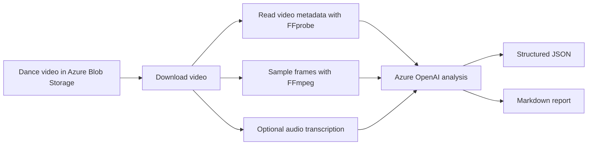
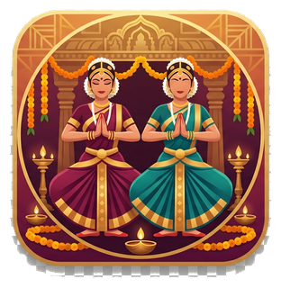

                Some experiments begin with a grand architecture diagram. This one began with a stage.

The recording looked simple at first: a wide camera angle, a decorated stage, and a group of Bharatanatyam dancers moving through formations under steady lights.

But anyone who has reviewed a dance performance knows the real work is hidden in the details. Did the side dancers balance the center? Did everyone arrive on the same beat? Were the arm lines consistent? Did the expression continue through transitions, or only appear in final poses?

A teacher can see these things, but reviewing a full performance takes time. A parent may notice the beauty but not always know the language of stagecraft. A student may remember the feeling of dancing, but not how the formation looked from the audience.

That became the cloud architecture question behind this experiment: can Azure OpenAI help turn a performance video into structured, respectful, and actionable coaching insight?

**Can Azure OpenAI help turn a performance video into useful coaching insight?**

This repository is my answer to that question.

## The idea

The goal was not to build a model that "judges" dancers. Dance is too human, too cultural, and too contextual for that.

Instead, the goal was to build an assistant that can watch carefully, describe what it sees, and help a teacher or parent start a better review conversation.

The solution focuses on three outputs:

1. **Video summary** - What happens in the performance?
2. **Dance/performance analysis** - What stagecraft and movement patterns are visible?
3. **Coaching feedback** - What can the group rehearse next?

The important part is that these outputs are connected. The summary tells the story of the video, the performance analysis explains what is visible in the dancing, and the coaching feedback turns those observations into rehearsal actions.

## How the pipeline works

From a cloud solution architecture perspective, the important decision was to separate media handling from model reasoning. Azure Blob Storage provides a simple landing zone for the video. FFmpeg and FFprobe handle deterministic media tasks such as metadata extraction and frame sampling. Azure OpenAI is then used only where reasoning is needed: interpreting visible formations, summarizing movement patterns, and generating coaching-oriented feedback.

This keeps the design modular, easier to troubleshoot, and more cost-aware than sending raw video directly into a model workflow.

The implementation intentionally uses sampled frames instead of uploading the full video directly.

## What the model saw

From the generated analysis, the video shows a Bharatanatyam ensemble on a proscenium stage with a decorated front banner and a simple purple-lit backdrop. The dancers move through straight lines, semi-circular formations, central framing, low stances, and overhead arm shapes.

The summary described the performance as:

> A group of Bharatanatyam dancers in traditional costumes perform a synchronized ensemble piece on a proscenium stage with coordinated formations and expressive hand gestures.

That one sentence is useful, but the richer value came from the next layer: turning observation into structured review.

## Video summary

The video-summary output captures the broad story of the performance: the stage setting, the visible arrangement of dancers, the approximate progression of formations, and notable moments such as central highlights, symmetrical poses, and level changes. It also records limitations, especially where sampled frames cannot fully capture every transition or musical detail.

## Dance and performance analysis

The performance-analysis output goes deeper. It looks at the group as an ensemble rather than singling out individual performers.

The strongest visible elements were the clarity of the group formations, good use of stage width, and a recurring central focal dancer framed by the ensemble. The costumes and stage presence created a cohesive visual identity, while the Bharatanatyam silhouettes — araimandi, arm lines, and stylized hand gestures — remained readable from the audience view. The choreography also moved thoughtfully between straight lines, arcs, diagonals, and central highlights against a clean stage setup.

The improvement areas were also practical rather than discouraging. Some spacing looked slightly uneven across the line, transitions could be tightened so dancers arrive together, and arm heights or elbow angles could be made more uniform. The model also noticed variation in araimandi depth, opportunities to strengthen expression and eye focus, and the possibility of using more stage depth. At the same time, it called out an important limitation: from a wide camera angle, close-up expression and mudra precision are difficult to judge confidently.

This is where AI becomes helpful: not because it replaces the teacher, but because it produces a first-pass review that a teacher can refine.

## Coaching feedback

The coaching section is the most actionable part of the output.

Instead of only saying "improve synchronization," the report turns observations into rehearsal drills:

- **Spacing drill:** mark a center line and side reference points, freeze on major poses, and check whether left and right pairs are balanced.
- **Timing drill:** clap the tala, mark the movement slowly, then isolate turns, jumps, and level changes until everyone lands together.
- **Arm-line drill:** choose a reference dancer or reference angle and match wrists, elbows, and shoulders across the group.
- **Araimandi drill:** practice consistent depth, turnout, and torso alignment using front and side video.
- **Expression drill:** rehearse drishti and bhava separately before combining them with the full choreography.
- **Group-awareness drill:** ask dancers to maintain spacing using peripheral vision, so the ensemble can self-correct without verbal cues.

That makes the output useful beyond documentation. It becomes a rehearsal companion.

One of my favorite parts of the generated feedback was the tone. It started with strengths: clear formations, coordinated costumes, composed stage presence, foundational posture, and a professional-looking central frame. Then it moved into corrections without making the feedback feel discouraging. That matters, especially for young learners.

## Why this matters

Video review is already part of dance training. Teachers, parents, and students watch recordings all the time. But manual review takes time, and it is easy to miss patterns when watching only once.

Azure OpenAI can help by acting as a repeatable second set of eyes. It can summarize the performance, organize observations, generate teacher-friendly feedback, and preserve visible limitations so the review stays grounded in evidence.

The important design choice is humility. The system should say what it can see, say what it cannot see, and avoid making claims about identity, age, intent, or cultural meaning that are not supported by the evidence.

## Benefits for students

For students, the biggest benefit is visibility. A dancer may feel that they are in line, bending deeply enough, matching the group, or looking in the right direction. The video review can show the stage picture from the audience perspective.

For students, the feedback becomes specific. They can look at whether side dancers are equally spaced from the center, whether arms reach the same height in group poses, whether everyone lands transitions on the same count, and whether araimandi depth looks consistent across the group. They can also review whether drishti stays lifted and intentional, and whether expression continues through transitions rather than appearing only in final poses.

That turns feedback from "dance better" into "watch this moment, freeze this frame, and correct this one detail." It also helps students celebrate what is already working: the ensemble shapes are readable, the costumes create a strong identity, and the group already has a clear performance structure.

## Benefits for teachers

For teachers, the value is time and structure.

A teacher still makes the artistic decisions. The AI does not know the full choreography, the dancer's training history, the intended bhava, or the teacher's style. But it can organize the first review into useful buckets: formation, timing, posture, expression, transitions, stage use, and production quality.

For this video, the output suggested a rehearsal plan that moved from spacing and stage coverage into transition timing, arm-line consistency, araimandi, expression, and group awareness. In other words, it turned the review into a structured practice agenda rather than a vague set of comments.

That is almost a ready-made rehearsal agenda. A teacher can accept it, adjust it, or ignore parts of it, but the blank page is gone.

It also creates a reusable review checklist. Instead of watching the whole video vaguely, the teacher can pause on major formations, compare arm lines, inspect transition arrivals, check central framing, and identify the strongest 10-20 second segment as a positive reference.

## Benefits for parents

For parents, the benefit is understanding.

Parents often see the final performance, but they may not know what to look for beyond "it looked beautiful." A structured summary helps them appreciate the craft behind the performance: spacing, symmetry, posture, expression, focus, timing, stage coverage, and group awareness.

It also helps parents support practice at home in a constructive way. Instead of vague comments, a parent can say:

> "Your group formations looked clear. In the next practice, maybe watch whether the side dancers are the same distance from the center."

or:

> "The final poses were strong. Now try checking whether everyone enters those poses together."

That keeps the conversation encouraging. It gives parents language that supports the teacher's work rather than replacing it.

## Responsible AI considerations

This solution is intentionally designed as an assistant, not an authority.

The model is asked to describe visible evidence, not judge artistic quality or infer personal attributes. It should not identify dancers, estimate age, assign intent, or make cultural claims beyond what is visible in the recording.

A teacher remains the final reviewer. The AI output should be treated as a first-pass observation layer that helps organize the review, not as a replacement for artistic expertise, cultural context, or student-specific coaching.

## Closing thought

The lesson from this experiment is not that AI can “understand” dance the way a teacher does. It cannot.

The lesson is that cloud AI can help organize observation. It can slow down a recording, surface patterns, turn vague impressions into rehearsal prompts, and help students, parents, and teachers have a better conversation.

In creative learning spaces, that is the role I want AI to play: not the judge, not the guru, and not the choreographer — but a patient reviewer that helps humans see their own work more clearly.

## Watch the performance video

