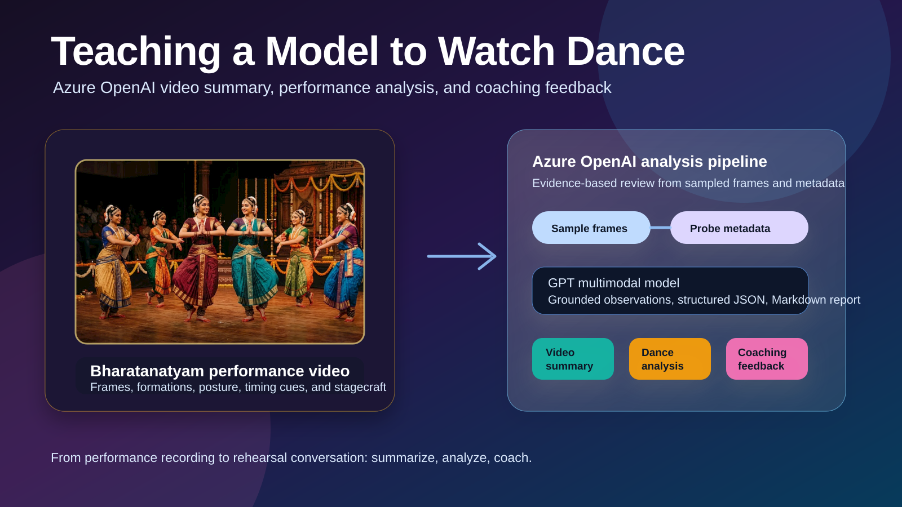
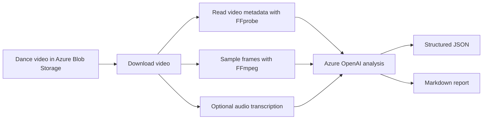
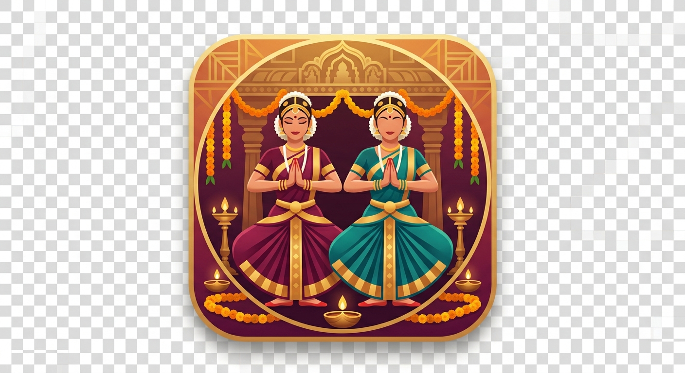

# Teaching a Model to Watch Dance

Some experiments begin with a grand architecture diagram. This one began with a stage.

The video was simple at first glance: a Bharatanatyam group performance, recorded from the audience, with dancers moving through lines, arcs, central highlights, low stances, and symmetrical poses. The camera stayed wide, the stage lighting stayed steady, and the real story lived in the formations: how the group filled the stage, how the dancers framed the center, how arm lines, timing, spacing, and expression came together.

That made it a perfect test case for a practical question:

**Can Azure OpenAI help turn a performance video into useful coaching insight?**

This repository is my answer to that question.

## The idea

The goal was not to build a model that "judges" dancers. Dance is too human, too cultural, and too contextual for that.

Instead, the goal was to build an assistant that can watch carefully, describe what it sees, and help a teacher or parent start a better review conversation.

The solution focuses on three outputs:

1. **Video summary** - What happens in the performance?
2. **Dance/performance analysis** - What stagecraft and movement patterns are visible?
3. **Coaching feedback** - What can the group rehearse next?

The important part is that these outputs are connected. The summary tells the story of the video, the performance analysis explains what is visible in the dancing, and the coaching feedback turns those observations into rehearsal actions.

## How the pipeline works

The video is stored in Azure Blob Storage. The local pipeline downloads it, samples representative frames, optionally extracts audio for transcription, and sends the evidence to an Azure OpenAI multimodal deployment.

The implementation intentionally uses sampled frames instead of uploading the full video directly.

## What the model saw

From the generated analysis, the video shows a Bharatanatyam ensemble on a proscenium stage with a decorated front banner and a simple purple-lit backdrop. The dancers move through straight lines, semi-circular formations, central framing, low stances, and overhead arm shapes.

The summary described the performance as:

> A group of Bharatanatyam dancers in traditional costumes perform a synchronized ensemble piece on a proscenium stage with coordinated formations and expressive hand gestures.

That one sentence is useful, but the richer value came from the next layer: turning observation into structured review.

## Video summary

The video-summary output captures the broad story of the performance:

- the setting and stage environment
- the visible number and arrangement of dancers
- the approximate timeline of formations
- notable moments such as central highlights, symmetrical poses, and level changes
- limitations, especially that sampled frames cannot fully capture every transition or musical detail

This is useful when you want a quick record of a performance without manually scrubbing through the video.

For this performance, the generated timeline called out moments such as a wide opening formation, a compact central line, semi-circular floor patterns, a straight front-facing line with coordinated hand positions, overhead arch-like arm shapes, mirrored side compositions, a central cluster, and a final low stance that created contrast between levels.

That kind of timeline becomes a memory aid. A teacher can quickly jump to likely rehearsal points. A parent can understand the structure of the piece. A student can see that the performance is not just "steps" but a sequence of stage pictures.

## Dance and performance analysis

The performance-analysis output goes deeper. It looks at the group as an ensemble rather than singling out individual performers.

The strongest visible elements were:

- clear group formations
- good use of stage width
- a recurring central focal dancer framed by the ensemble
- coordinated costumes and stage presence
- readable Bharatanatyam silhouettes with araimandi, arm lines, and stylized hand gestures
- thoughtful changes between straight lines, arcs, diagonals, and central highlights
- a clean stage setup that kept attention on the dancers

The analysis also found practical improvement areas:

- spacing was sometimes slightly uneven across the line
- transitions could be tightened so dancers arrive together
- arm heights and elbow angles could be more uniform
- araimandi depth varied between dancers
- expression and eye focus could be strengthened for better abhinaya impact
- use of stage depth could be expanded so the choreography feels more layered
- close-up expression and mudra precision were hard to judge from the wide camera angle

This is where AI becomes helpful: not because it replaces the teacher, but because it produces a first-pass review that a teacher can refine.

## Coaching feedback

The coaching section is the most actionable part of the output.

Instead of only saying "improve synchronization," the report turns observations into rehearsal drills:

- **Spacing drill:** mark a center line and side reference points, freeze on major poses, and check whether left and right pairs are balanced.
- **Timing drill:** clap the tala, mark the movement slowly, then isolate turns, jumps, and level changes until everyone lands together.
- **Arm-line drill:** choose a reference dancer or reference angle and match wrists, elbows, and shoulders across the group.
- **Araimandi drill:** practice consistent depth, turnout, and torso alignment using front and side video.
- **Expression drill:** rehearse drishti and bhava separately before combining them with the full choreography.
- **Group-awareness drill:** ask dancers to maintain spacing using peripheral vision, so the ensemble can self-correct without verbal cues.

That makes the output useful beyond documentation. It becomes a rehearsal companion.

One of my favorite parts of the generated feedback was the tone. It started with strengths: clear formations, coordinated costumes, composed stage presence, foundational posture, and a professional-looking central frame. Then it moved into corrections without making the feedback feel discouraging. That matters, especially for young learners.

## Why this matters

Video review is already part of dance training. Teachers, parents, and students watch recordings all the time. But manual review takes time, and it is easy to miss patterns when watching only once.

Azure OpenAI can help by creating a repeatable second set of eyes:

- summarize the performance
- organize observations by category
- generate teacher-friendly feedback
- produce checklists for the next rehearsal
- keep track of visible limitations and uncertainty

The important design choice is humility. The system should say what it can see, say what it cannot see, and avoid making claims about identity, age, intent, or cultural meaning that are not supported by the evidence.

## Benefits for students

For students, the biggest benefit is visibility. A dancer may feel that they are in line, bending deeply enough, matching the group, or looking in the right direction. The video review can show the stage picture from the audience perspective.

In this performance, the generated feedback gives students specific things to look for:

- whether left and right side dancers are equally spaced from the center
- whether arms reach the same height in group poses
- whether everyone lands transitions on the same count
- whether araimandi depth looks consistent across the group
- whether drishti stays lifted and intentional
- whether expression continues through transitions, not only final poses

That turns feedback from "dance better" into "watch this moment, freeze this frame, and correct this one detail." It also helps students celebrate what is already working: the ensemble shapes are readable, the costumes create a strong identity, and the group already has a clear performance structure.

## Benefits for teachers

For teachers, the value is time and structure.

A teacher still makes the artistic decisions. The AI does not know the full choreography, the dancer's training history, the intended bhava, or the teacher's style. But it can organize the first review into useful buckets: formation, timing, posture, expression, transitions, stage use, and production quality.

For this video, the output suggested a practical rehearsal plan:

- 20 minutes for spacing symmetry and stage coverage
- 25 minutes for transition timing and synchronization
- 15 minutes for uniform arm lines and hand positions
- 20 minutes for araimandi and level changes
- 20 minutes for expression, drishti, and abhinaya
- 15 minutes for stage awareness and group cohesion

That is almost a ready-made rehearsal agenda. A teacher can accept it, adjust it, or ignore parts of it, but the blank page is gone.

It also creates a reusable review checklist. Instead of watching the whole video vaguely, the teacher can pause on major formations, compare arm lines, inspect transition arrivals, check central framing, and identify the strongest 10-20 second segment as a positive reference.

## Benefits for parents

For parents, the benefit is understanding.

Parents often see the final performance, but they may not know what to look for beyond "it looked beautiful." A structured summary helps them appreciate the craft behind the performance: spacing, symmetry, posture, expression, focus, timing, stage coverage, and group awareness.

It also helps parents support practice at home in a constructive way. Instead of vague comments, a parent can say:

> "Your group formations looked clear. In the next practice, maybe watch whether the side dancers are the same distance from the center."

or:

> "The final poses were strong. Now try checking whether everyone enters those poses together."

That keeps the conversation encouraging. It gives parents language that supports the teacher's work rather than replacing it.

## Closing thought

The best part of this experiment was not that the model could describe a dance video.

The best part was that it could turn a recording into a conversation: What worked well? What should we practice next? What should the dancers feel proud of? What can the teacher focus on in the next rehearsal?

That is the kind of AI assistant I want in creative learning spaces: not a judge, not a replacement for expertise, but a patient reviewer that helps humans see their own work more clearly.

## Watch the performance video

